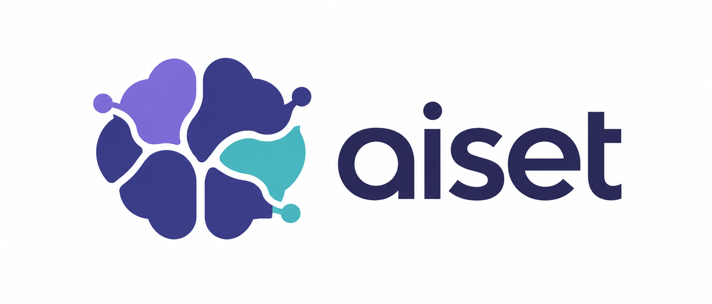

<p align="center">
  
</p>

<h1 align="center">A shared brain for your AI agents.</h1>

<p align="center">
  Persistent project knowledge. Shared decisions. Less repeated work.
</p>

<p align="center">
  <a href="#quick-start">Quick start</a> ·
  <a href="#memory-that-outlives-a-chat">How memory works</a> ·
  <a href="docs/USER-GUIDE.md">User guide</a> ·
  <a href="docs/RESEARCH-TOOLS.md">Research & evaluation</a> ·
  <a href="LICENSE">MIT license</a>
</p>

**Aiset gives AI coding agents a shared, persistent brain for your project.** It connects repository knowledge, working rules, past decisions, and task history so the next task can build on what the team already learned.

Explain a convention, resolve a tricky bug, or agree on an API contract: save that knowledge once, then make it available to the agents that need it in later sessions. Aiset also gives you a live office to see who is working, what they are reading, and where tokens are going.

**Currently built for Claude Code.** Aiset generates a project team and provides local memory, research tools, and a browser interface around its work.

## Memory that outlives a chat

A fresh conversation should not mean rediscovering your project from scratch. Aiset keeps the team's knowledge in workspace files that survive session restarts.

| What the team should remember | Where it lives | How it is reused |
|---|---|---|
| Project structure, conventions, known pitfalls | Knowledge briefs and dated **Field notes** | Engineers are instructed to read their brief index and relevant sections before working, including Field notes. |
| Working rules and role responsibilities | Agent instruction files | The selected agent receives its instructions when a new session starts. |
| Current requirements and API agreements | Task boards: brief, contract, handoffs, log | Agents coordinate through the same written task context. |
| What was done, why, and what went wrong | **Episodes** written when a task closes | Later research can find previous decisions, touched files, and lessons. |
| Code relationships and previous research | Code graphs and research records | `teammap` retrieves relevant evidence without requiring a full repository read. |

### Make a rule part of the team's memory

For example, tell your PM:

> “Use cursor-based pagination for new list endpoints. Save this convention in the relevant engineers' knowledge briefs, and include it in the contract for this task.”

Or after solving a problem:

> “Record why this failed, the verified fix, and the affected files in the episode. Add the reusable lesson to the owning engineer's Field notes.”

The next task can retrieve that rule or lesson from the shared files, even after the original conversation ends.

**Persistence depends on writing and retrieval.** Aiset does not automatically turn every question or chat message into a permanent rule, and saved instructions do not guarantee perfect agent compliance. Ask the team to record important decisions, check the saved files, and refresh knowledge when the code changes. The Brain page makes those records and their connections visible.

## Less rediscovery. More useful work.

Aiset is designed to reduce the context agents need to consume before they can act:

- **Read the right section.** Brief indexes expose headings and line ranges so agents can open the relevant parts instead of entire documents.
- **Share task context.** Boards and handoffs let agents reference the same requirements rather than repeatedly relaying them through the PM.
- **Reuse earlier lessons.** Episodes and Field notes preserve discoveries that would otherwise need to be made again.
- **Query the code.** `teammap` returns definitions, callers, models, and architecture evidence with source locations.
- **Filter research output.** Focused tools return findings and coverage gaps, with access to the full stored result when needed.

These mechanisms target wasted work; they are not a promise of a fixed token reduction. The current research evaluation includes output-size measurements, which are **not** actual token savings. See [measured results and limitations](docs/RESEARCH-TOOLS.md).

## One team, four views

| View | What you can see or control |
|---|---|
| **Office** | Live agent activity, assignments, task boards, model usage, tokens, and estimated costs. |
| **Brain** | The connections between agents, knowledge, episodes, repositories, and files; follow an agent's route through the project. |
| **Architecture** | Services, infrastructure, and dependencies, with source evidence and a distinction between exact and inferred links. |
| **Settings** | Team names, roles, models, office layout, and history windows. |

The PM clarifies the request and coordinates the work. Engineers work on their assigned repositories; QA and integration agents check the result. Knowledge and task records stay with the workspace.

## Quick start

**Requirements:** Python 3.9+, Git, and Claude Code for agent sessions. The Python package has no third-party runtime dependencies. TypeScript indexing additionally needs Node.js and an accessible TypeScript installation.

From a clone of this repository:

```sh
python -m pip install -e .
```

Create a team for your project folder:

```sh
aiset-init ~/work/example-project --team example-project
```

Start the PM from that workspace:

```sh
cd ~/work/example-project
claude --agent pm
```

For the first task, ask:

> “Build the knowledge briefs. Document the architecture, conventions, test commands, and known pitfalls for each repository.”

In another terminal, open the office:

```sh
aiset --workspace ~/work/example-project
```

Visit **http://127.0.0.1:8765**. Use **Brain** to explore the team's knowledge and **Settings** to personalize the team.

Both folders of repositories and monorepos are supported. Team generation detects repository stacks and can group large workspaces by stack. The bundled sample roster is for exploration; `aiset-init` creates the actual agent files for your project.

## Ask the brain before searching from scratch

Run these commands from your initialized workspace:

```sh
# Find relevant code, brief sections, and previous episodes.
teammap relevant "product batch stock adjustment"

# Trace the potential impact of an API change.
teammap impact /products/{product_id} PATCH

# Extract failures from an existing test log.
teammap failures ./test-output.log

# Inspect a stored research result in full.
teammap research show <id>
```

Results include source references, exact or inferred findings, and known gaps. Use `--json` for structured output and `--max-chars` to limit displayed text. See the [research tools guide](docs/USER-GUIDE.md#research-tools-teammap-impact-failures-relevant) for supported formats and options.

## Your workspace owns the memory

```text
example-project/
└── .claude/
    ├── agents/          # Role instructions and working rules
    └── team/
        ├── roster.json  # Team members and repository ownership
        ├── knowledge/   # Persistent briefs, indexes, and Field notes
        ├── tasks/       # Requirements, contracts, and handoffs
        ├── episodes/    # Completed tasks, decisions, and lessons
        └── graph/       # Code graphs, indexes, and research data
```

The memory is inspectable and editable on disk. Separate workspaces can maintain separate teams. For monorepos, generated `.claude/` files are excluded locally from Git by default; use `--share` when you intend to version them.

The dashboard runs on localhost and reads Claude Code transcripts. It also updates agent names, settings, brief indexes, and graph caches. Model requests still follow your Claude Code setup; a local dashboard does not mean offline model execution. The dashboard is intended for local use, not public hosting.

## Development

```sh
python -m unittest discover -s tests
```

The package lives in `src/aiset/`; tests, documentation, and evaluation scripts live in `tests/`, `docs/`, and `eval/`. If Make is available, run `make` to list shortcuts for setup, checks, indexing, and evaluation. Agent evaluation runs can incur model usage costs.

- [User guide](docs/USER-GUIDE.md): detailed setup, interface, CLI, and settings.
- [Feature inventory](docs/FEATURES.md): current functionality and gaps.
- [Research tools](docs/RESEARCH-TOOLS.md): evaluation results and limitations.
- [Brand assets](docs/branding/preview.html): selected logo and application icons.

## License

[MIT](LICENSE).
