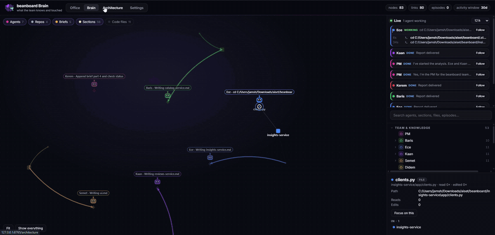

<div align="center">


# aiset

### The shared brain for your AI coding team

Turn your repositories into a team of Claude Code agents that remember what they learn,<br>
work in parallel, and show you every step, live.

<br>

[](pyproject.toml)
[](pyproject.toml)
[](https://claude.com/claude-code)
[](docs/USER-GUIDE.md)
[](LICENSE)

**[Quick start](#quick-start)** &nbsp;·&nbsp; **[Tour](#a-real-run-start-to-finish)** &nbsp;·&nbsp; **[Commands](#commands)** &nbsp;·&nbsp; **[User guide](docs/USER-GUIDE.md)** &nbsp;·&nbsp; **[Research](docs/RESEARCH-TOOLS.md)**

<br>


<sub>The Office, live: the PM waits on two engineers fixing bugs in parallel. Real recording, sped up 1.5×.</sub>

</div>

<br>

## Quick start

```sh
pip install -e .                                   # from a clone: adds aiset, aiset-init, teammap
aiset-init ~/work/shop --team shop                 # scan the repos, generate the team
shop-pm                                            # talk to your PM, from any folder
```

Then open the office in a second terminal with `aiset` and visit **http://127.0.0.1:8765**.

Give the PM its first task:

> *"Build the knowledge briefs. Document the architecture, conventions, test commands and known pitfalls for each repository."*

<sub>Needs Python 3.9+, Git and [Claude Code](https://claude.com/claude-code). TypeScript indexing also uses Node.js. Works with a folder of repositories or a monorepo.</sub>

<br>

## Why aiset

Coding agents start every session from zero. They re-read the same files, rediscover the same conventions and repeat the same investigations, and you can't see what they're doing until they're done.

<table>
<tr>
<td width="33%" valign="top">

#### Remember

Conventions, decisions and lessons live in **workspace memory**: knowledge briefs, field notes and task episodes that survive a restart and are plain files you can read and edit.

</td>
<td width="33%" valign="top">

#### Coordinate

`aiset-init` generates a **PM, one engineer per repo or stack, QA and an integration checker**. The PM plans, assigns, and verifies work before reporting back.

</td>
<td width="33%" valign="top">

#### See

A local dashboard shows **who is doing what, what they read, what it costs**, and how your services connect, read straight from the code.

</td>
</tr>
</table>

<br>

## A real run, start to finish

Every frame below comes from **Beanboard**, a small demo app: three FastAPI services (catalog on PostgreSQL, reviews on MongoDB, insights calling both) and a React UI on Docker Compose. One `aiset-init` turned it into a team of seven. Nothing is staged.

### 1 &nbsp;Ask in plain words

You describe a feature. The PM pins down scope before anyone writes code.


### 2 &nbsp;The team works in parallel

The PM writes a task board and hands each engineer an assignment with the contract to follow. You watch status, model and cost per task, then open a task to see every file each agent read and edited.



### 3 &nbsp;Follow every read and edit

The **Brain** draws live trails from each agent to the briefs, files and services it touches.


### 4 &nbsp;Get a verified report

Findings come back ranked, with file and line references, proposed fixes and effort. The full handoffs stay in the workspace.


### 5 &nbsp;The knowledge compounds

After two tasks the Brain connects 7 agents, 4 repositories, 5 briefs with 56 sections and 2 episodes to the code's 13 endpoints, 8 models and 10 frontend API calls. The next task starts there, not from zero.


### 6 &nbsp;Architecture, read from the code

Services, databases and the calls between them, each backed by a file and line. Solid links are exact; dashed links are inferred from names.


<br>

## What's inside

| | |
|---|---|
| **Office** | Live isometric or classic view of the team: assignments, task boards, activity feed, models, tokens and estimated cost per agent. |
| **Brain** | One graph of agents, briefs, sections, episodes, files, endpoints, models and API calls. Follow an agent, search anything, focus on a node. |
| **Architecture** | Static map of frontends, APIs, workers and infrastructure (PostgreSQL, MongoDB, Redis, RabbitMQ, Kafka, Keycloak and more), with evidence for every link. Exports Mermaid. |
| **Settings** | Names, roles, colours, duties and the **model per agent**: put routine work on Sonnet or Haiku, keep Opus where it matters. |
| **teammap** | Code-aware research for agents and people: endpoint → handler → frontend callers, change impact, relevant context for a task, test-failure triage. |
| **Launchers** | `aiset-init` writes a `<team>-pm` command, so the PM is one word away from any folder. |

<br>

## Commands

| Command | What it does |
|---|---|
| `aiset-init <folder> [--team NAME]` | Detect stacks, generate the roster, agents and brief stubs in `<folder>/.claude/`. Safe to re-run: keeps your names, adds new repos. |
| `<team>-pm` | Start the PM in its workspace from anywhere. Extra arguments go to Claude Code, e.g. `shop-pm --model sonnet`. |
| `aiset [--workspace FOLDER\|TEAM]` | Open the office. Without `--workspace`: the workspace you're in, else the team you set up most recently. |
| `teammap relevant "<task>"` | Files, symbols, endpoints, brief sections and past episodes to read first. |
| `teammap impact <path\|symbol\|Model> [METHOD]` | What a change can reach: consumers, models, importers, tests. Exact vs inferred. |
| `teammap failures <log>` | Failed tests, messages and in-repo frames from a saved test run, grouped. |
| `teammap endpoint` · `model` · `arch` · `symbol` | Direct lookups. `teammap --help` lists them all. |

<details>
<summary><b>Example: what does changing an endpoint break?</b></summary>
<br>

```console
$ teammap impact "/api/catalog/beans/{bean_id}" PATCH
impact · endpoint PATCH /api/catalog/beans/{bean_id}
  PATCH /api/catalog/beans/{bean_id} is handled by update_bean() in catalog-service/app/routes.py:37
  4 consumer(s) found (1 exact), 2 model(s), 2 test file(s)
models (2)
  = catalog-service/app/schemas.py:18  BeanUpdate  6 fields
      request parameter payload: BeanUpdate
  = catalog-service/app/schemas.py:27  Bean  8 fields
      response_model Bean
consumers (4)
  = ui/src/api.ts:50  updateBean  PATCH /api/catalog/beans/{}
      HTTP call to the same URL
  ~ ui/src/pages/BeanDetailPage.tsx:40  BeanDetailPage.savePrice
      calls updateBean() (matched by name)
  …
```

`=` is exact (from the code's structure), `~` is inferred (by name, URL or text). Add `--json` for structured output.

</details>

<br>

## How it works

```text
your-project/
├── catalog-service/ · reviews-service/ · ui/ …   your code, untouched
└── .claude/
    ├── agents/          PM, engineers, QA, integration checker (Claude Code loads these)
    └── team/
        ├── roster.json  who owns which repo, and on which model
        ├── knowledge/   briefs: architecture, conventions, pitfalls, dated field notes
        ├── tasks/       boards, contracts, handoffs
        ├── episodes/    what each finished task decided and learned
        └── graph/       code index, Brain graph, stored research results
```

Engineers read their brief's index and only the sections they need. When a task closes, the PM writes an episode and carries the lessons into the owner's brief, which is how the next task starts ahead.

Everything is plain Markdown and JSON in your workspace. In a monorepo, `.claude/` is kept out of git by default; pass `--share` to version it with the team.

> [!NOTE]
> **Memory is a workflow, not perfect recall.** Agents are instructed to save and retrieve knowledge, but not every chat message becomes a rule. Review the briefs now and then, as you would any documentation.

> [!NOTE]
> **On token savings:** the research tools return far less text than the greps and reads they replace ([measurements](docs/RESEARCH-TOOLS.md)), but that's output size, not proven end-to-end token savings. Real usage depends on the task.

<br>

## Privacy

- **Local only.** The dashboard binds to `127.0.0.1` and checks `Host` and `Origin` headers. It's not built for public hosting.
- **No new data flows.** aiset reads the transcripts Claude Code already writes. Model calls go through your own Claude Code setup, nothing else.
- **No secrets read.** The architecture scan reads env var *names* only, and never opens `.env` files or `secrets/` folders.
- **Zero runtime dependencies.** Python standard library only.

<br>

## FAQ

<details>
<summary><b><code>aiset-init</code> is "not recognized" after installing</b></summary>
<br>

pip put the commands in a folder that isn't on your PATH. That's common with the Microsoft Store Python, which uses `%LOCALAPPDATA%\Packages\PythonSoftwareFoundation.Python.3.x_…\LocalCache\local-packages\Python3xx\Scripts`. Add the folder pip printed in its warning to PATH, then open a new terminal. In the meantime, `python -m aiset.init_team` and `python -m aiset.server` work too.

</details>

<details>
<summary><b>PowerShell says "running scripts is disabled"</b></summary>
<br>

That's PowerShell's execution policy blocking npm's `claude.ps1`. The `<team>-pm` launcher is a `.cmd`, so it isn't affected. For plain `claude`, run `Set-ExecutionPolicy -Scope CurrentUser RemoteSigned` once, or call `claude.cmd`.

</details>

<details>
<summary><b>Which models does the team use?</b></summary>
<br>

Whatever you choose per agent in **Settings**; it's written into each agent file. Without a choice, agents use your Claude Code default.

</details>

<details>
<summary><b>Big workspaces and monorepos?</b></summary>
<br>

A folder of repos gets one engineer per repo. A monorepo gets one per service folder. Above 12 units, or with `--group stack`, you get one engineer per stack (Java, Node.js, Python, frontend) instead.

</details>

<details>
<summary><b>The Brain or Office looks empty</b></summary>
<br>

The office shows one workspace at a time and prints which one at startup. Run `aiset --workspace <team>` to pick a team explicitly.

</details>

<br>

## Contributing

Issues and pull requests are welcome. Read [CONTRIBUTING.md](CONTRIBUTING.md) for setup and guidelines (`make check` runs everything), and report vulnerabilities privately as described in [SECURITY.md](SECURITY.md).

More docs: [User guide](docs/USER-GUIDE.md) · [Feature inventory](docs/FEATURES.md) · [Research tools](docs/RESEARCH-TOOLS.md) · [Brand assets](docs/branding/preview.html)

<br>

<div align="center">

<br>
<sub>MIT licensed · Built for <a href="https://claude.com/claude-code">Claude Code</a></sub>
</div>
