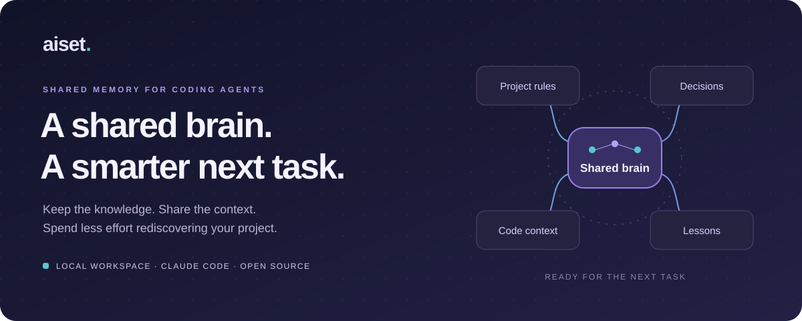
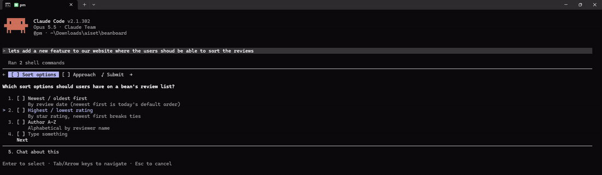
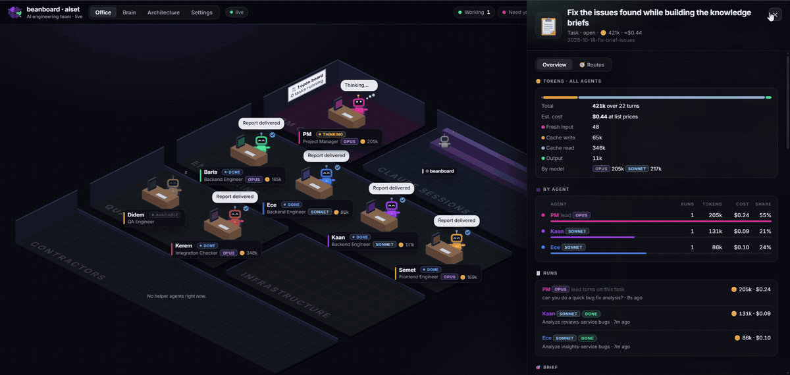
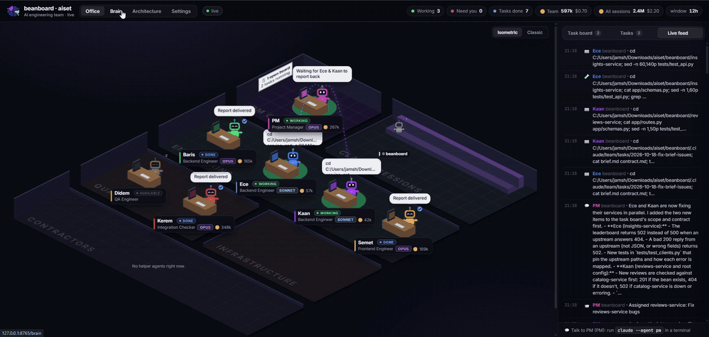
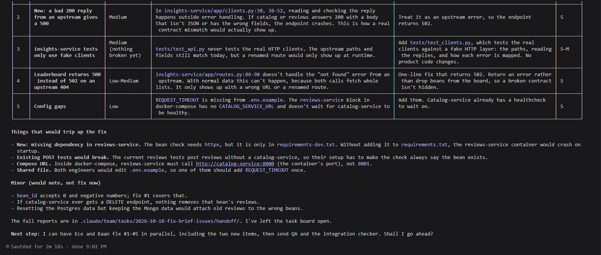
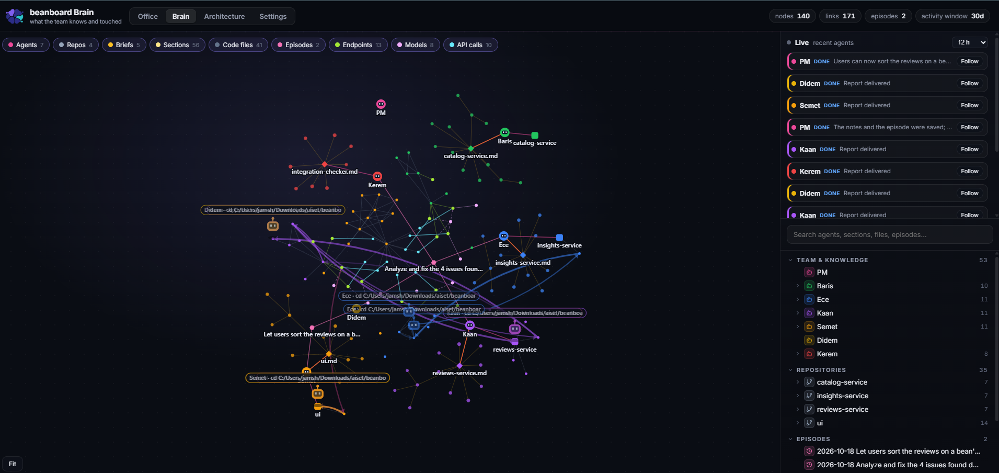
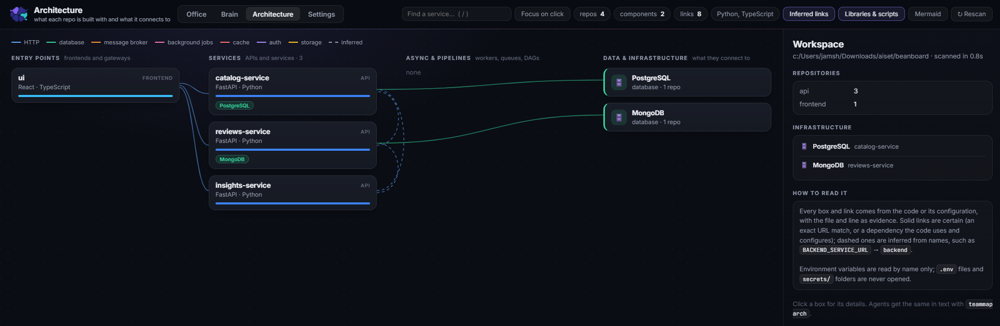

<p align="center">
  
</p>

<p align="center"><strong>aiset</strong> &nbsp; / &nbsp; The shared brain for your AI coding team</p>

<p align="center">
  <a href="#quick-start"><strong>Get started →</strong></a> &nbsp; · &nbsp;
  <a href="docs/USER-GUIDE.md">Explore the guide</a> &nbsp; · &nbsp;
  <a href="docs/RESEARCH-TOOLS.md">Read the research</a>
</p>

<p align="center">
  
</p>

<p align="center">
  <strong>Persistent memory</strong> &nbsp; / &nbsp; <strong>Focused context</strong> &nbsp; / &nbsp; <strong>Visible teamwork</strong>
  <br>
  <sub>Built for Claude Code · Python 3.9+ · MIT licensed</sub>
</p>

<br>

## Your team learns. The next task benefits.

**Aiset gives coding agents a shared, persistent brain for your project.** Save conventions, capture decisions, and carry useful lessons into future sessions. A live office shows how the team uses that knowledge—and where its tokens go.

<table>
<tr>
<td width="33%" valign="top">

### 01 · Remember

Keep project conventions, decisions, and lessons in **workspace memory** that survives a chat restart.

</td>
<td width="33%" valign="top">

### 02 · Retrieve

Find **the context a task needs**: brief sections, relevant code, and earlier episodes—with sources.

</td>
<td width="33%" valign="top">

### 03 · Reuse

Build on previous discoveries and shared task boards. **Reduce repeated investigation** across the team.

</td>
</tr>
</table>

## From one conversation to shared knowledge

<table>
<tr><th align="left">You set a convention</th><th align="left">The team records it</th><th align="left">A later task retrieves it</th></tr>
<tr>
<td width="33%" valign="top">“Use cursor-based pagination for new list endpoints. Save this in the backend brief.”</td>
<td width="33%" valign="top">The engineer adds it to <strong>Field notes</strong>; the task contract captures the agreement.</td>
<td width="33%" valign="top">The next engineer reads the brief and uses the saved convention as context.</td>
</tr>
</table>

> **Memory is a workflow, not a promise of perfect recall.** Important information must be saved and retrieved. Aiset's agent instructions guide that process; not every chat message is automatically stored as a rule. Review recorded knowledge and refresh it as the project changes.

<details>
<summary><strong>Inside the brain: what is remembered, and where?</strong></summary>

| Memory | Stored as | Used for |
|---|---|---|
| Conventions and pitfalls | Knowledge briefs + dated Field notes | Giving the next task a useful starting point |
| Roles and working rules | Agent instruction files | Guiding the selected agent in a new session |
| Requirements and agreements | Task briefs, contracts, handoffs, logs | Keeping agents aligned on active work |
| Decisions and lessons | Episodes written when tasks close | Finding earlier solutions and their reasoning |
| Code relationships | Graphs, indexes, research records | Retrieving evidence without reading the whole repo |

Engineers are instructed to read their brief index, relevant sections, and Field notes. When a task closes, the PM writes an episode and carries reusable lessons into the owning engineer's brief.

</details>

<br>

## See the work. Follow the knowledge.

<table>
<tr>
<td width="50%" valign="top">

### Office

Your team's live workspace. Follow assignments, task boards, agent activity, models, tokens, and estimated costs.

</td>
<td width="50%" valign="top">

### Brain

Explore the connections between agents, briefs, episodes, and code. Follow an agent's path through the project.

</td>
</tr>
<tr>
<td width="50%" valign="top">

### Architecture

See how services and infrastructure connect. Inspect source evidence and distinguish exact links from inferred ones.

</td>
<td width="50%" valign="top">

### Settings

Shape the team: names, roles, models, layout, and history windows, all in one place.

</td>
</tr>
</table>

## Watch a real run

These recordings are from **Beanboard**, a small demo app: three FastAPI services (catalog on PostgreSQL, reviews on MongoDB, and an insights service that calls both) and a React UI, run with Docker Compose. `aiset-init` turned it into a team of seven agents. Nothing below is staged.

**1 · You talk to the PM.** Ask for a feature in plain words. The PM clarifies scope before anyone writes code.

<p align="center"></p>

**2 · The team works in the Office.** The PM assigns tasks, engineers pick them up in parallel, and every agent shows its assignment, status, model and token use.

<p align="center"></p>

**3 · The Brain shows what they read and change.** Live trails link each agent to the briefs, files and services it touches.

<p align="center"></p>

**4 · The PM reports back.** Findings are ranked with file references and proposed fixes. The full reports stay in the workspace for the next task.

<p align="center"></p>

**5 · The knowledge stays.** After two tasks, the Brain links seven agents to 4 repositories, 5 briefs with 56 sections, 2 episodes, and the code's 13 endpoints, 8 models and 10 frontend API calls. The next task starts from that context.

<p align="center"></p>

**6 · The architecture is read from the code.** Aiset finds the UI calling all three services, catalog on PostgreSQL, reviews on MongoDB, and insights calling the other two (dashed: inferred from names). Each link has the file and line as evidence.

<p align="center"></p>

## Spend context where it matters

**Read sections, not entire briefs.** Share task context instead of repeatedly relaying it. Query code relationships and saved lessons before starting another investigation.

Aiset combines brief indexes, shared boards, source-linked code queries, and focused research output to target unnecessary reading and repeated work.

[See the measurements →](docs/RESEARCH-TOOLS.md) Current results include output-size comparisons, **not proven token savings**. Actual usage depends on the task and how agents use the tools.

---
## Quick start

**Requirements:** Python 3.9+, Git, and Claude Code for agent sessions. The Python package has no third-party runtime dependencies. TypeScript indexing additionally needs Node.js and an accessible TypeScript installation.

From a clone of this repository:

```sh
python -m pip install -e .
```

Create a team for your project folder:

```sh
aiset-init ~/work/example-project --team example-project
```

Start the PM. `aiset-init` adds a `<team>-pm` command that works from any folder:

```sh
example-project-pm        # same as: cd ~/work/example-project && claude --agent pm
```

For the first task, ask:

> “Build the knowledge briefs. Document the architecture, conventions, test commands, and known pitfalls for each repository.”

In another terminal, open the office:

```sh
aiset --workspace example-project     # a team name or a folder; plain `aiset` shows the newest team
```

Visit **http://127.0.0.1:8765**. Use **Brain** to explore the team's knowledge and **Settings** to personalize the team.

Both folders of repositories and monorepos are supported. Team generation detects repository stacks and can group large workspaces by stack. The bundled sample roster is for exploration; `aiset-init` creates the actual agent files for your project.

<details>
<summary><strong>Research commands · ask the brain before searching from scratch</strong></summary>


Run these commands from your initialized workspace:

```sh
# Find relevant code, brief sections, and previous episodes.
teammap relevant "product batch stock adjustment"

# Trace the potential impact of an API change.
teammap impact /products/{product_id} PATCH

# Extract failures from an existing test log.
teammap failures ./test-output.log

# Inspect a stored research result in full.
teammap research show <id>
```

Results include source references, exact or inferred findings, and known gaps. Use `--json` for structured output and `--max-chars` to limit displayed text. See the [research tools guide](docs/USER-GUIDE.md#research-tools-teammap-impact-failures-relevant) for supported formats and options.


</details>

<details>
<summary><strong>Storage & privacy · your workspace owns the memory</strong></summary>


```text
example-project/
└── .claude/
    ├── agents/          # Role instructions and working rules
    └── team/
        ├── roster.json  # Team members and repository ownership
        ├── knowledge/   # Persistent briefs, indexes, and Field notes
        ├── tasks/       # Requirements, contracts, and handoffs
        ├── episodes/    # Completed tasks, decisions, and lessons
        └── graph/       # Code graphs, indexes, and research data
```

The memory is inspectable and editable on disk. Separate workspaces can maintain separate teams. For monorepos, generated `.claude/` files are excluded locally from Git by default; use `--share` when you intend to version them.

The dashboard runs on localhost and reads Claude Code transcripts. It also updates agent names, settings, brief indexes, and graph caches. Model requests still follow your Claude Code setup; a local dashboard does not mean offline model execution. The dashboard is intended for local use, not public hosting.


</details>

---

## Development

```sh
python -m unittest discover -s tests
```

The package lives in `src/aiset/`; tests, documentation, and evaluation scripts live in `tests/`, `docs/`, and `eval/`. If Make is available, run `make` to list shortcuts for setup, checks, indexing, and evaluation. Agent evaluation runs can incur model usage costs.

- [User guide](docs/USER-GUIDE.md): detailed setup, interface, CLI, and settings.
- [Feature inventory](docs/FEATURES.md): current functionality and gaps.
- [Research tools](docs/RESEARCH-TOOLS.md): evaluation results and limitations.
- [Brand assets](docs/branding/preview.html): selected logo and application icons.
- [Contributing](CONTRIBUTING.md): setup, guidelines, and how to send a pull request.
- [Security policy](SECURITY.md): how to report a vulnerability privately.

## License

[MIT](LICENSE).
